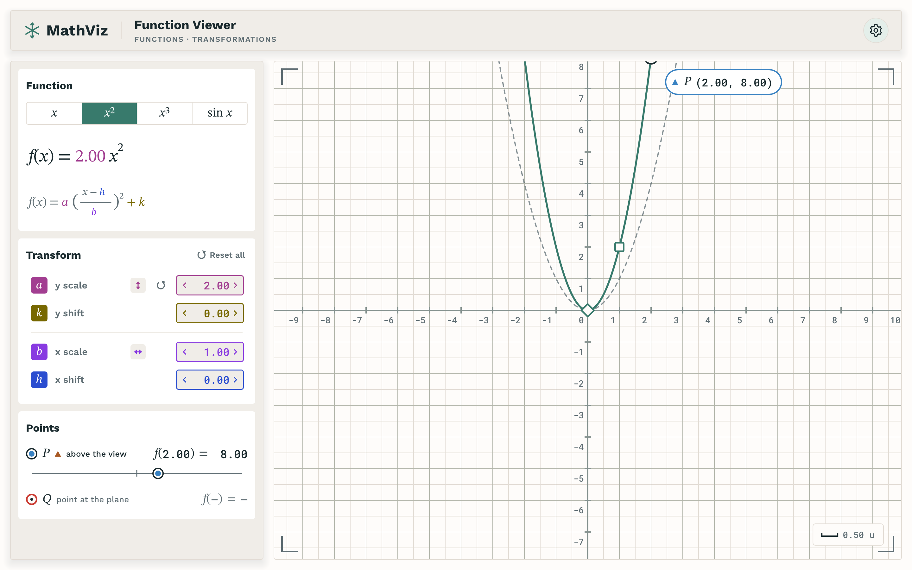
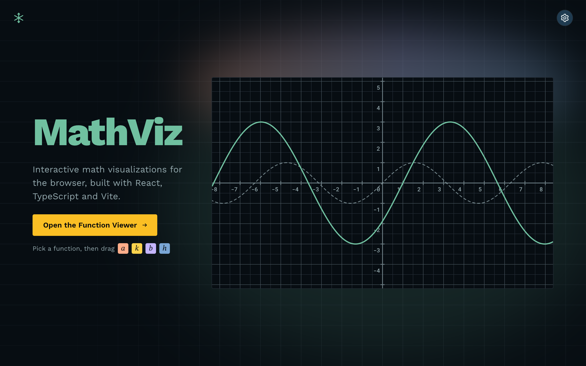

# math-viz-rust

The [MathViz](https://github.com/niels4/math-viz) Function Viewer, ported to Rust by AI agents. One codebase builds a native app for macOS, Windows and Linux (SDL3, OpenGL) and a WebAssembly app for the browser. A high-fidelity port of the original design and implementation.

### [Open the live app →](https://niels4.github.io/math-viz-rust/)

<a href="https://niels4.github.io/math-viz-rust/#function-viewer">
  
</a>

<a href="https://niels4.github.io/math-viz-rust/">
  
</a>

**[Function Viewer](https://niels4.github.io/math-viz-rust/#function-viewer):** pick a function, then drag its handles or scrub a, b, h and k to stretch and shift the curve. Pan and zoom the plane. Slide P along the curve and read its value.

## Why Clay, SDL and Rust

I had been playing around with [Odin](https://odin-lang.org/), building native apps with [Clay](https://github.com/nicbarker/clay) for layout and [SDL3](https://libsdl.org/) for the window, input and GPU, and liked how little stood between the code and the screen. Rust seems to be the popular language for automated app building, so I combined the two: the Odin-style native stack, written in Rust by AI agents.

| Layer | Library |
|---|---|
| Window, input, GPU context, main loop | [SDL3](https://libsdl.org/) |
| Layout | [Clay](https://github.com/nicbarker/clay) |
| Vector drawing | [NanoVG](https://github.com/memononen/nanovg) |
| Text shaping | [kb_text_shape](https://github.com/JimmyLefevre/kb) |
| Web build | [Emscripten](https://emscripten.org/) |

The C libraries are vendored and wrapped in thin Rust bindings; everything above them is plain Rust.

## How it was built

The original is a React app that grew commit by commit. Rather than hand the agents a spec, the orchestrator read the original's git history, cut it into milestones, and built the port in the same order, so the Rust app passed through the same states the original did. When the original gained commits during the run, they became the next milestones.

| Role | Did |
|---|---|
| **Driver** (Claude Opus) | Ran the whole thing: planned, cut branches, spawned every agent, merged in order, asked the few questions that needed a human |
| **Planner** (a larger Claude model) | Turned the original's history into milestones, briefs and agent definitions |
| **Porters** (a cheaper model, many at once) | Ported the pure modules, test for test and value for value |
| **Coders** (a cheaper model, several at once) | Wired each milestone into the running app, judged by pixels and behaviour against the original |
| **Reviewers** (three per milestone) | A pixel recount, a code and idiom read, and a trial merge against the sibling branches |
| **Operators** | Worktrees, reference servers, merges, whole-app check runs |

What kept it fast and honest:

- **Parallel by default.** Every milestone on its own branch and worktree, against its own pinned build of the original. The next milestone started before the previous one merged; only the wiring waited. Merges landed in history order.
- **The original as the oracle.** One script drives the original, the web build and the native build to the same state in three browser engines and compares the screenshots pixel for pixel. Native and web had to match exactly; differences from the original were measured region by region, with browser quirks recorded once.
- **Tests as the anchor.** The original's unit tests were ported one for one, and a drift scan compared every ported function with its source. The Rust could change shape, never behaviour.
- **Reviews beside merges.** No merge waited for a review; findings became fix-forward work.
- **A human, lightly.** I answered a handful of questions, reported two things I saw, and merged to main when I wanted to deploy.

The Function Viewer reached parity with the original in under nine hours; the welcome screen followed the same morning, and the welcome page's link into the viewer and the point dragged on the graph came after that. About 300 commits, 600 unit tests and 230 scripted states across three browser engines and the native build. The first attempt, a port of an Odin version of the app, had taken 28 hours the day before; this run reused its libraries, harness and lessons.

The native app was verified on macOS and the web app in WebKit, Chromium and Firefox; the Windows and Linux builds come from the same sources and are untested so far. Deliberate differences from the original are listed in `decisions.md`.

## Where the port stands

At math-viz2's `c6754e7`: the whole Function Viewer and the welcome screen beside it. The stretch from the first history milestone (h1) to the last (h11) was ported commit by commit -- the page shell with the top bar and the settings menu, the Cartesian plane with pan, flick, wheel zoom and the URL camera, the sidebar with the function picker, the readout and the transform rows with their scrub boxes, rulers and flip, the damped flip and the shift/scale handles with their lines, the P/Q points with their markers, drop lines and slider, the welcome screen at the root route with its loop and its fit to the window, and then the four app commits past it: the default function x², the welcome page's graph as a link into the viewer, the hover derived from the hovered point, and P dragged along the curve on the graph itself. Every milestone was judged state by state against math-viz2 at that milestone's commit, in three browser engines and the native build.

## Running it

Needs Rust 1.99 with the `wasm32-unknown-emscripten` target, Emscripten 6.0.12 and SDL3 (`brew install sdl3` on macOS). [BUILDING.md](BUILDING.md) has the setup, every flag, and the harness.

The native app opens on the welcome page, as the browser's `/` does; `--route function-viewer` opens the viewer straight away. The web build has the two routes at `/` and `/#function-viewer`, and the viewer opens on x².

```sh
./build.sh native        # build/native/function-viewer
./build.sh web           # build/web/, serve it as static files
./build.sh check         # fmt, clippy, tests and both builds
./build.sh pages         # docs/: the web app for GitHub Pages
```

## Your own checks

What the harness can't measure, because it runs headless with synthesised input: no display, no real pointer or keyboard, Playwright's WebKit instead of Safari.

- **A real trackpad and mouse on the plane:** drag, flick (a fling glides on and eases to a stop), wheel and two-finger scroll zoom about the cursor, pinch to zoom. Check: in the native window and in Safari, beside math-viz2 in Safari.
- **The scrub drag with a real mouse:** a value box drag (moves after 3 px; Shift fine at a tenth, Ctrl snaps; the ruler rides under k's row), the wheel over a box, arrow nudges, Esc revert, double-click reset, both tips. Check: in the native window and in Safari.
- **The handle and slider drags with a real mouse:** the shift diamond and scale square (both params lit, rulers out while held), the x-of-P slider (thumb jumps to the pointer, arrows/Home/End, Enter opens the field). Check: in the native window and in Safari.
- **Dragging P along the curve with a real mouse:** the open hand over P, the closed one while it is held, and the slider's thumb showing its dragging look. Check: in the native window and in Safari, beside math-viz2 in Safari.
- **Clicking the hero mid-loop:** the welcome page's graph is a link into the viewer, so a click on it navigates and the cursor is a hand over it. Check: the native window and Safari, while the welcome loop plays.
- **The welcome loop at real speed:** the tour through scrubs and switches, natively and in Safari (the harness judges paused-clock frames, not motion). Check: `build/release/native/function-viewer` left running on the welcome page, and the web build in Safari.
- **The fit in a real window:** resize a Safari window across 1024x640, 1280x1000, 1280x800 and 768x1024 (every part inside, no scrolling; the menu under the gear at natural size in a small window; the plane sharp on a 2x and a 1x screen). Check: the web build in a real Safari window.
- **The sidebar's scroll:** the sidebar's content is taller than a short window, so it scrolls; a wheel over it scrolls the panel, a wheel over the plane zooms. Check: the native window and Safari at 1024x640.
- **Safari itself:** the web build beside math-viz2 at 1440x900. Tab walks fields in Safari only with "Press Tab to highlight each item" on (the port follows the Chromium order); buttons don't take focus on click there.
- **The composited colour on your display:** Digital Color Meter in Display P3 on a param chip in the native window, in the web build in Safari, and in math-viz2 in Safari -- the same.
- **Text weight under macOS smoothing:** the browsers' text carries more ink than the port's at small sizes; kept as drawn. Check: the title and the readout beside math-viz2 in Safari.
- **The system theme flipping the running app:** Appearance Light/Dark in System with the menu open and closed (the page follows at once with its 250 ms fade); Reduce motion on (switches land at once, no frames).
- **The view transition's feel:** the 250 ms linear cross-fade on a theme pick, real trackpad and display vs the paused clock.
- **Prefs across a real restart:** pick a theme and a mode, quit, launch again: the same (`prefs.json` under the app's own path); in Safari a reload keeps them (the port's own keys); math-viz2's own settings untouched either way.
- **The web build's URL:** reload and back/forward across `/` and `/#function-viewer` (history entries from the wordmark, the button and the hero), a theme pick recolours both routes.
- **The popover and menu feel:** the settings menu's open/close (its 160 ms animation is skipped in the port), the macOS focus ring vs the port's ring, the rest tip's 400 ms delay, the typing tip while typing.
- **The Arctic Ice Secondary by eye:** the recolored Secondary against the card background, dark room and bright room, in a live window.
- **A Windows and a Linux build:** build and run each, and its `--script` frames against macOS's (`tools/run diff`).

## Known gaps

What the port leaves out, one line each with how you check it yourself.

- **Screen readers.** SDL and Clay expose no accessibility tree, so a screen reader finds nothing on the page; the keyboard model (Tab, focus rings, every key) is what remains. Check: VoiceOver over the native window and the web build.
- **The not-found page and the dev pages.** The template's not-found route, the developer theme-demo page and the two links that point at them are not ported; an unknown hash shows the welcome page, and the settings menu is 44 CSS px shorter than math-viz2's. Check: any other `#word` in the web build, and the foot of the settings menu.
- **The font-loading state.** Natively fonts are always loaded, so labels always show; a cold web load may flash fallback faces before the fonts arrive, unmeasured. Check: a cold load with the cache off.
- **Click-to-caret placement.** Clicking into a typing field collapses the caret to the end; only whole scalars delete. Check: click mid-text while typing, natively.
- **Touch.** One finger may act as the mouse, but pinch and multi-touch are untested on a phone or tablet. Check: the web build in Safari on an iPhone and an iPad.
- **Static text doesn't select.** Field text selects while editing, but static labels never do. Check: drag across a row name in the port.

## The harness

`tools/` is a small Python project that puts the original, the web build and the native build in the same state from one script and compares them at threshold 0, in WebKit, Chromium and Firefox. It is what judged every milestone.

```sh
tools/setup                                      # the venv
tools/run states H1 --targets ref,web,native     # one state group on every target
tools/run states all --jobs 8                    # the whole catalogue
tools/run judge .local/shots/H1                  # pixels apart from the original, by region
tools/run sweep                                  # motion and input at off-grid timings
```

MIT licensed.
